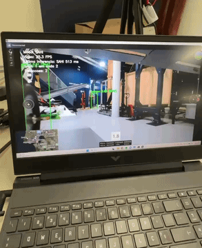

# ATLAS-Jetson

Pipeline utilizada no **Jetson Xavier NX** para receber vídeo da **SIYI A8 Mini**, detetar pessoas com **YOLO11s / SAHI** e reencaminhar para a air unit da SIYI, sendo depois recebido no solo pela **ATLAS Video Control** através do SIYI **HM30**.

## Demonstração

Deteção de pessoas em tempo real com YOLO11s / SAHI no Jetson Xavier NX, com retransmissão do vídeo processado para a ATLAS Video Control através do SIYI HM30.



## Ficheiros

| Ficheiro | Finalidade |
| --- | --- |
| `setup_network.sh` | Ativa a bridge e perfis NetworkManager existentes, verifica A8/HM30 e cria um proxy TCP `37256` usando `socat`. |
| `scripts/atlas_vision_local.py` | Vídeo processado com janela OpenCV no monitor do Jetson. |
| `scripts/atlas_vision_headless.py` | Mesmo processamento, sem janela gráfica, com controlo pelo terminal SSH. |
| `yolo11s.pt` | Pesos YOLO11s utilizados nas duas versões. |
| `docs/OPERACAO.md` | Execução local/remota e arquitetura. |
| `docs/INSTALACAO.md` | Dependências, estado da rede e verificações sem alterações. |
| `docs/API_PLANEADA.md` | Próxima fase: API Jetson ↔ ATLAS (ainda não implementada). |

## Execução resumida

O script de rede original encontra-se na raiz do Desktop no Jetson:

```bash
bash /home/atlas/Desktop/setup_network.sh
```

> Este comando **altera interfaces e perfis de rede**: executar apenas na configuração original, depois de confirmar a interface de acesso SSH e os perfis NetworkManager. O script pode esperar indefinidamente por ligações ausentes.

### Com monitor

```bash
cd /home/atlas/Desktop/ATLAS-Jetson/scripts
MODEL_PATH=/home/atlas/Desktop/ATLAS-Jetson/yolo11s.pt python3 atlas_vision_local.py
```

### Sem monitor (SSH)

```bash
ssh -t atlas@192.168.144.100
cd /home/atlas/Desktop/ATLAS-Jetson/scripts
MODEL_PATH=/home/atlas/Desktop/ATLAS-Jetson/yolo11s.pt python3 atlas_vision_headless.py
```

Os comandos acima reproduzem os **caminhos históricos** do Desktop; se clonares o repositório noutra pasta, adapta os caminhos dos ficheiros em conformidade.

**Vídeo original:** `rtsp://192.168.144.25:8554/main.264` (o codec efetivo é H.265).

**Vídeo processado:** `rtsp://192.168.144.100:8555/camera` (H.264).

As teclas são `S` (YOLO/SAHI), `[` e `]` (frequência SAHI), `Q` (sair). O modo SSH precisa de terminal interativo e o processo termina quando a sessão é encerrada, salvo se houver gestão de sessão externa.

## Limitações e segurança

- Os scripts **detetam pessoas**, mas não implementam tracking persistente, identificação individual, movimentos da gimbal ou API HTTP para o ATLAS.
- O servidor gera até 25 FPS de saída configurados, o que **não equivale** a 25 inferências por segundo; pode repetir frames.
- As dependências JetPack/CUDA/PyTorch/OpenCV/GStreamer instaladas no dispositivo não são recuperáveis apenas a partir da cópia do Desktop.
- O script de rede depende dos perfis `atlas-siyi`, `atlas-siyi-eth1`, `atlas-siyi-eth2`, previamente existentes no NetworkManager.
- A porta TCP `37256` corresponde ao proxy de gimbal do script de rede e **não deve ser confundida** com a interface de controlo SIYI UDP usada noutras integrações.
- Não adicionar chaves privadas ou credenciais ao repositório.

